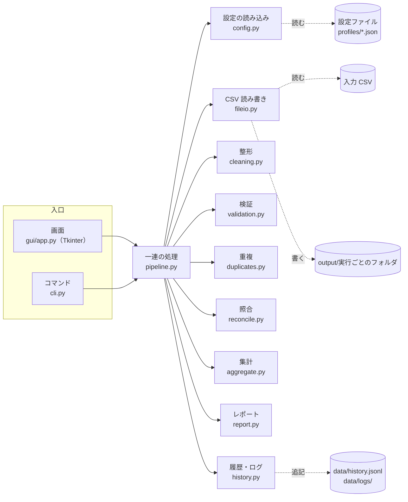
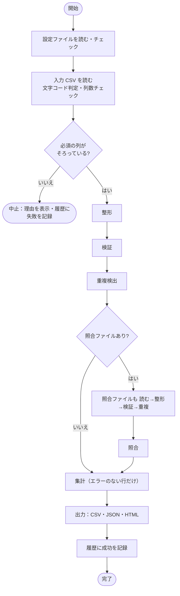

# 02 基本設計書

## 1. 技術構成図



- 画面とコマンドは同じ `pipeline.run()` を呼ぶ。業務ロジックは画面に持たせない
- 各モジュールは pandas の表（DataFrame）を受け取って返すだけの関数にし、単体でテストできるようにする
- 業務ごとの違い（列・ルール・集計・照合）は設定ファイルに書く

## 2. 処理の流れ



エラーの扱いは2種類に分ける。

| 種類 | 例 | 扱い |
| --- | --- | --- |
| 行のエラー | 必須が空欄、日付が読めない、重複 | 処理は続ける。エラー一覧に記録し、正常データから外す |
| 処理を続けられないエラー | ファイルがない、文字コード不明、必須の列がない、設定の誤り | 中止して理由を表示。出力フォルダは作らない。履歴に「失敗」を残す |

## 3. 画面設計

1つのウィンドウで完結する。左にメニュー、右にページを出すダッシュボード型。ダーク（暗い配色）とライト（明るい配色）を切り替えられる。

```
┌──────────────┬──────────────────────────────────────────────┐
│ 業務データ処理ツール │ ダッシュボード       ■■■□ [出力フォルダ][レポート][処理を実行] │
│ CSVの整形・検証・集計 │ 完了：42 行のうち 正常 30 行・エラーのある行 12 行            │
│ ──────────── │ ■ 処理結果のまとめ                                        │
│ [▦ ダッシュボード]   │ ┌データ行数┐┌正常な行┐┌エラーのある行┐┌重複┐  ← 色つきカード │
│ [▶ ファイルと実行]   │ │   42   ││  30  ││    12    ││ 2 │                │
│ [› データ        ]   │ └─────┘└────┘└──────┘└──┘                │
│ [› エラー一覧    ]   │ ▲▼ いちばん多い・少ない項目   集計[商品別売上▼] 比べる値[売上金額▼] │
│ [› 重複          ]   │ ┌▲ いちばん多い ───────┐┌▼ いちばん少ない ─────┐   │
│ [› 照合          ]   │ │ CP-300 キャップ ネイビー  ││ ST-205 ステッカー     │   │
│ [› 集計          ]   │ └───────────────┘└──────────────┘   │
│ [› 処理履歴      ]   │ 商品別売上（棒グラフ）        チェック別のエラー件数（横棒） │
│                      │ 照合の結果（横棒）            列ごとのエラー件数（横棒）     │
│ 表示モード           │                                                            │
│ [☀ ライトモードにする] │                                                            │
└──────────────┴──────────────────────────────────────────────┘
```

| ページ | 内容 |
| --- | --- |
| ダッシュボード | 件数のカード 4 枚、選んだ集計で値がいちばん多い・少ない項目のカード、グラフ 4 つ（集計・チェック別のエラー・照合の結果・列ごとのエラー） |
| ファイルと実行 | CSV・設定ファイル・照合する CSV・出力先・文字コードを選ぶ。「中身を見る」「処理を実行」、使い方の説明 |
| データ | 読み込んだ CSV（実行後は整形後のデータ）。先頭 1,000 行 |
| エラー一覧 | 重要度・チェックの種類・文字で絞り込み。エラーは赤、注意は黄色 |
| 重複 | 重複したグループと「最初の行（残す）／重複（エラー）」 |
| 照合 | 照合結果で絞り込み。不一致は赤、片方のみは黄色、一致は緑 |
| 集計 | 集計を選んで表示。最後に合計行 |
| 処理履歴 | 過去の処理（新しい順）。失敗は赤 |

- 上の帯（ページ名・進み具合・「出力フォルダを開く」「レポートを開く」「処理を実行」）はどのページでも同じ場所に出す
- 処理は別スレッドで動かし、進み具合をプログレスバーに出す（画面が固まらない）
- 実行中は「処理を実行」ボタンを押せないようにする（二重実行の防止）
- グラフの色：値が大きいほど緑（エラー件数のグラフは大きいほど赤）。照合は 一致＝緑・不一致＝赤・片方のみ＝黄
- 表示モードは左下のボタンで切り替え、次に開いたときも同じモードで開く
## 4. 出力ファイル

実行ごとに `出力先/日時-ミリ秒_入力ファイル名/` を作る。

| ファイル | 内容 |
| --- | --- |
| 01_整形済みデータ.csv | 全行（整形後）。先頭に行番号 |
| 02_正常データ.csv / .json | エラーのない行だけ |
| 03_エラー一覧.csv | ファイル・行番号・列・値・チェック・内容・重要度 |
| 04_重複一覧.csv | 重複グループ・区分・行の内容 |
| 05_整形の変更記録.csv | 行番号・列・変更前・変更後 |
| 06_照合結果.csv | 照合したときだけ |
| 07-n_集計_名前.csv | 設定の集計ごと |
| summary.json | 件数のまとめ（機械で読む用） |
| report.html | 人が見る用のレポート |

## 5. データ（ファイル）設計

本作品はデータベースを使わない。保存するデータは次のファイルだけ。

| ファイル | 形式 | 内容 |
| --- | --- | --- |
| profiles/*.json | JSON | 設定（詳細設計書 3 章） |
| data/history.jsonl | JSON Lines | 1 処理 1 行：run_id・開始・状態・設定・入力ファイル名と SHA-256・行数・エラー件数・照合件数・出力先・処理時間・メッセージ |
| data/settings.json | JSON | 画面の表示モード（dark / light） |
| data/logs/dataprep.log | テキスト | 処理の開始・終了・中止・想定外のエラーの詳細（1MB で切り替え、5 世代） |

`data/` の場所は環境変数 `DATAPREP_HOME` またはコマンドの `--home` で変えられる。
